<!-- Self-contained SVG cards: no projects are featured on this profile. -->

  

[LinkedIn](https://www.linkedin.com/in/daksh-gangwar-1aa740313/) &nbsp;·&nbsp; [Instagram](https://instagram.com/daksh_gangwar14) &nbsp;·&nbsp; [Email](mailto:dakshgangwar05@gmail.com)

